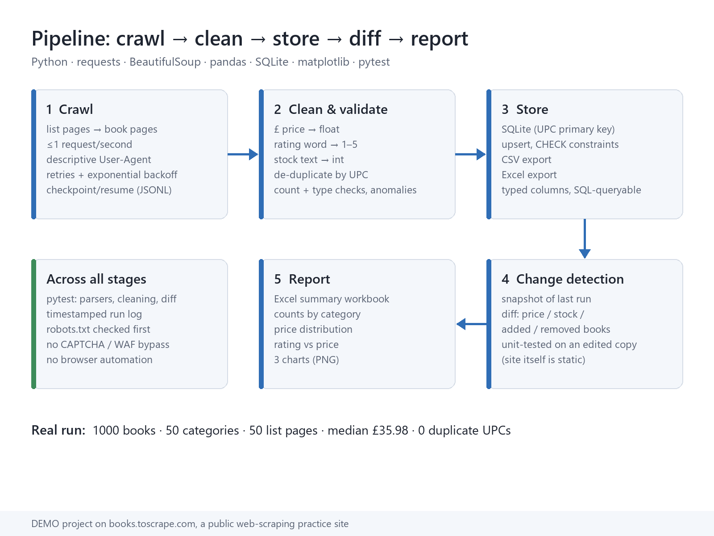
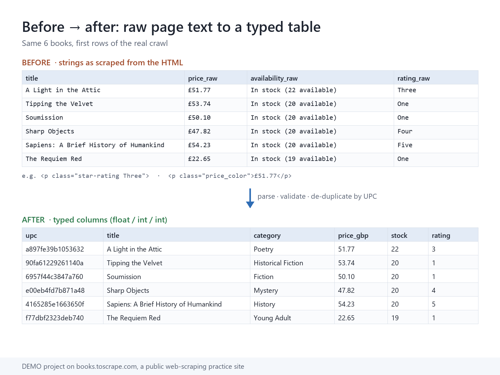
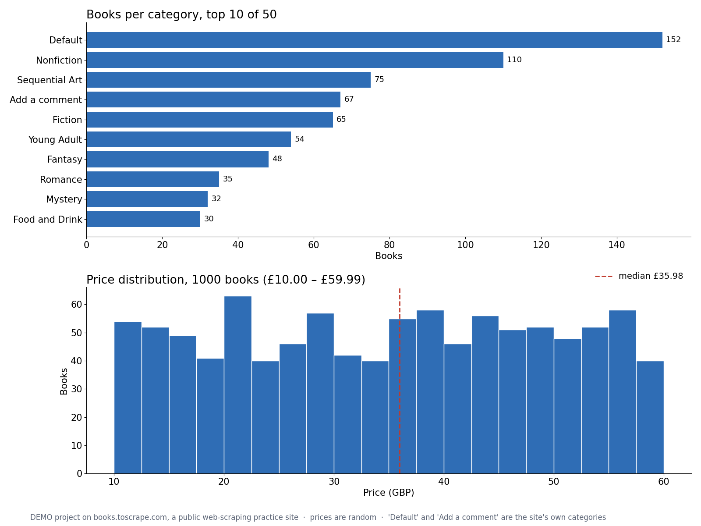
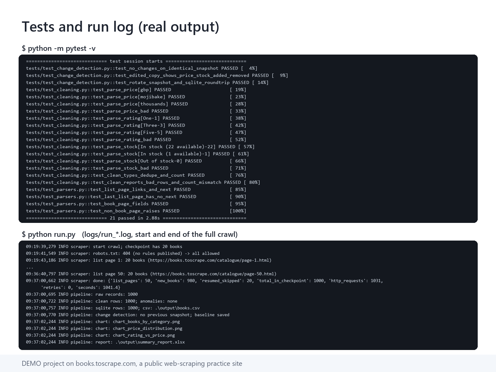
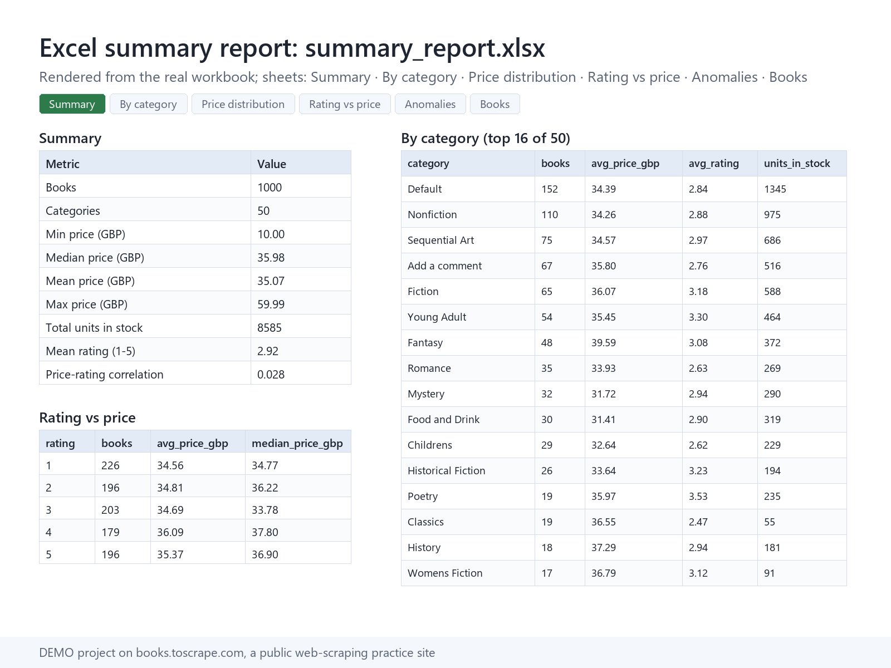

# Web Scraper Demo: Data Pipeline

> **This is a demo project by SheldonTek.** It runs only against
> [books.toscrape.com](https://books.toscrape.com/), a public website built for web-scraping practice.
> The site's own homepage banner reads:
> *"Warning! This is a demo website for web scraping purposes. Prices and ratings here were randomly
> assigned and have no real meaning."*
> No client data and no real market data are involved. The point is the engineering:
> crawl → clean → store → diff → report.



## Results of the real run (2026-10-24)
- 50 list pages, **1,000 books**. The crawl stopped at the site's natural end (no "next" link after page 50).
- 1,031 HTTP requests (robots.txt, 50 list pages, 980 book pages; 20 books were resumed from an earlier
  checkpoint), **0 retries**, 1,041 seconds at 1 request/second.
- Cleaning: 1,000 rows, 1,000 unique UPCs, 0 duplicates, 0 unparseable rows, 0 anomalies.
  The count matches the site's 1,000.
- 50 categories. Price £10.00–£59.99, median £35.98, mean £35.07. Units in stock: 8,585. Mean rating 2.92.
  Price–rating correlation 0.028, as expected for randomly assigned data.
- "Default" (152 books) and "Add a comment" (67 books) are real category names on the site and are kept as is.
- Change detection: a rebuild against the saved snapshot found 0 changes, which is correct for a static site.
  The non-zero case (price, stock, added, removed) is covered by unit tests on an edited copy of a snapshot.
- Tests: **21 passed** (`python -m pytest -v`).

Sample outputs from that run are committed in [`output/`](output/): `books.csv`, `summary_report.xlsx`
and three charts. Portfolio images are in [`docs/`](docs/).

| | |
|---|---|
|  |  |
|  |  |

## What it does
1. **Crawl** (`bookscraper/scraper.py`): walks the 50 catalogue list pages, then every book page, and stops when
   there is no "next" link. Fields: title, price, availability, rating, category, UPC, URL, scraped_at.
2. **Clean** (`bookscraper/cleaning.py`): `£51.77` → `51.77`, `Three` → `3`, `In stock (22 available)` → `22`.
   De-duplicates by UPC; checks types, empty fields, positive prices and the expected count of 1,000, and
   lists anything odd as an anomaly.
3. **Store** (`bookscraper/storage.py`): SQLite (`data/books.sqlite`, UPC primary key, upsert, CHECK constraint)
   plus a `output/books.csv` export.
4. **Change detection**: each run is compared with `data/snapshot_prev.csv`; price, stock, added and removed
   changes go to `output/changes.csv`.
5. **Report** (`bookscraper/report.py`): `output/summary_report.xlsx` with sheets Summary, By category,
   Price distribution, Rating vs price, Anomalies and Books, plus 3 PNG charts.

## Run
Tested on Python 3.13.
```bash
pip install -r requirements.txt
python run.py                 # full crawl (~18 min at 1 req/s); resumes from data/raw_books.jsonl
python run.py --max-pages 2   # quick sample
python run.py --skip-crawl    # rebuild outputs from the checkpoint
python -m pytest -v           # offline tests, uses saved HTML fixtures
```
`data/` (SQLite, checkpoint, snapshot) and `logs/` are created on the first run and are not committed.
`tools/make_portfolio_assets.py` renders the `docs/` images from real outputs; it uses Windows system fonts.

## Design notes
- **Polite crawling**: at most 1 request per second, sequential, with a descriptive User-Agent
  (`SheldonTek-DemoScraper/1.0 ...`). Retries on 5xx, 429 or network errors back off at 2, 4, 8 and 16 seconds;
  other 4xx errors are not retried.
- **robots.txt checked on every run**: the crawler stops if the catalogue is disallowed. On 2026-10-24
  books.toscrape.com returned HTTP 404 for robots.txt, so it publishes no rules (`evidence/`).
- **No evasion**: plain `requests` only. No browser automation, no proxy rotation, no CAPTCHA solving and
  no WAF bypass. If a site blocks or disallows access, the job stops there.
- **Resume**: every finished book is appended and flushed to a JSONL checkpoint, so an interrupted run
  continues where it left off.
- **Parsing and typing are kept apart**: parsers return page text as is and cleaning does all conversion,
  so each part is tested on its own.

The same structure fits real jobs such as product catalogues, price monitoring and listings, on sites you
are allowed to collect from, within their terms and robots.txt.

## Contact
SheldonTek: https://sheldontek.com

## License
MIT © 2026 SheldonTek Co., Limited. See [LICENSE](LICENSE).
